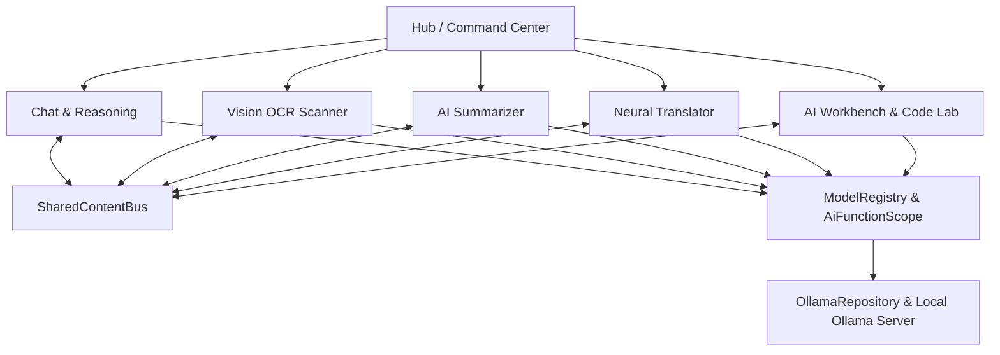

# Celestia AI Suite - Architecture Summary

## Overview
Celestia is a high-performance Android application providing an offline-capable, locally hosted LLM AI Suite powered by Ollama. The app features a unified inter-operable design system with glassmorphic rendering, per-function model dispatching, cross-tool data handoffs ("Send to..."), and advanced technical data visualization (Excel-like scrollable tables and dynamic bar graphs).

---

## Core Architectural Pillars

1. **Global Model Dispatcher (`ModelRegistry` & `AiFunctionScope`)**:
   - Allows users to independently configure local Ollama models per feature domain (Chat, Scanner/OCR, Summarize, Translate, Workbench).
   - Backed by persistent `UserPreferences` and quick-switch modal bottom sheets.

2. **Unified Data Bus (`SharedContentBus`)**:
   - Backed by a reactive `StateFlow` payload bridge that allows seamless data handoffs between tools.
   - Example: Scanning a document in **Scanner** and instantly routing OCR text into a new **Chat** session or **Summarize** canvas with one tap.

3. **Advanced Technical Output Rendering (`CelestiaMarkdownView`)**:
   - Automatically parses Markdown tables (`| Col 1 | Col 2 |`) into interactive, horizontally scrollable **Excel-like Spreadsheet Tables** (`CelestiaExcelTableView`) with zebra striping and CSV copy export.
   - Automatically detects numeric data series and generates animated **Bar Charts & Graphs** (`CelestiaBarChartView`) with a 1-tap toggle.
   - Supports executable Python code blocks with on-device evaluation, LaTeX math formatting, and web link previews.
